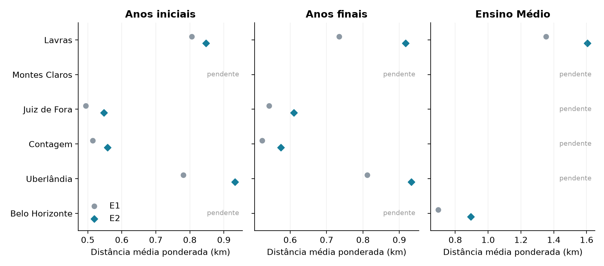
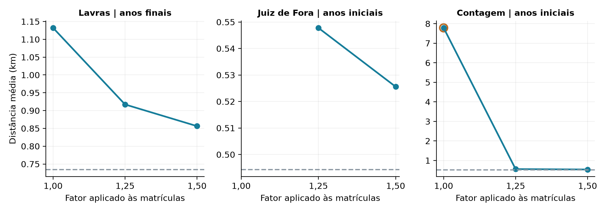
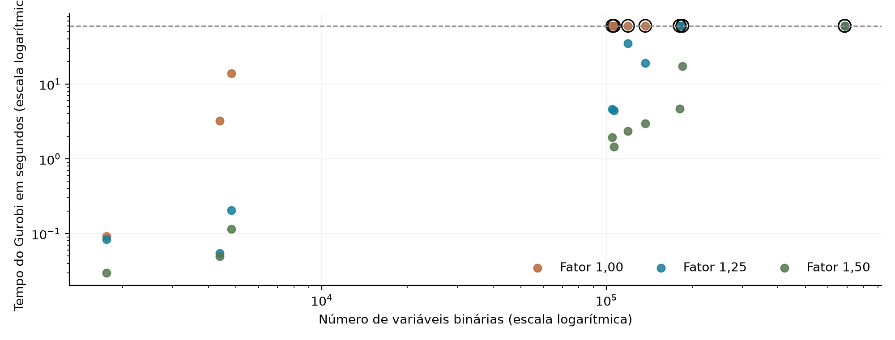

# Alocação escolar capacitada em municípios de Minas Gerais

Formulação exata e experimentos em municípios completos

GCC118 — Programação Matemática

A ampliação considera as cinco maiores cidades de Minas Gerais por população e Lavras. Dos 72 casos planejados, 40 foram executados e 32 dependem de coordenadas escolares. Os resultados permitem comparar acessibilidade e esforço computacional, preservando todos os setores de cada município.

## 1 Problema e dados

O estudo atribui integralmente a demanda estimada de cada setor censitário a uma escola pública existente. Anos iniciais, anos finais e Ensino Médio propedêutico são tratados separadamente. Todas as escolas elegíveis ficam disponíveis. O modelo não seleciona unidades para fechamento nem define novas localizações.

O Censo 2022 do IBGE fornece setores, população e os grupos originais de 5 a 9, 10 a 14 e 15 a 19 anos. O INEP 2025 V2 fornece matrículas e oferta escolar. Endereços e coordenadas vêm do Catálogo de Escolas, com apoio da SEE MG de 05/11/2026 e complementos do OpenStreetMap por GeoPy e Nominatim. As fontes são integradas pelos códigos do setor e da escola.

## 2 Demanda e capacidade

A demanda calibrada distribui o total de matrículas elegíveis D segundo o perfil etário Aᵢ dos setores. Contagens suprimidas permanecem ausentes na fonte e recebem uma estimativa separada, baseada na população do setor e na proporção etária dos setores conhecidos.

\[
\widetilde{w}_i = D\frac{A_i}{\sum_k A_k}
\]

O método dos maiores restos converte as parcelas em demandas inteiras wᵢ cuja soma é D. A calibração preserva o total de matrículas, mas não comprova a residência dos estudantes. Os grupos etários são aproximações das etapas, sem interpolar faixas do IBGE.

\[
Q_j=\lceil\alpha M_j\rceil,\quad \alpha\in\{1.00,1.25,1.50\}
\]

Mⱼ é a matrícula observada na etapa e α assume 1,00, 1,25 e 1,50. A capacidade Qⱼ é uma hipótese experimental. Não representa capacidade física ou vagas disponíveis. Os aumentos de 25% e 50% alteram apenas essa hipótese, mantendo o número de escolas.

## 3 Experimentos e formulação

| Cenário | O que decide e o que permite |
| --- | --- |
| E1 | Atribui cada setor à escola mais próxima, sem limite de capacidade. É a referência de menor distância. |
| E2 | Atribui cada setor a uma escola respeitando Qⱼ. Pode exigir deslocamentos maiores ou tornar a instância inviável. |

I contém todos os setores do município e J contém as escolas públicas ativas com matrículas positivas na etapa. A variável binária xᵢⱼ vale 1 quando o setor i é atribuído à escola j. O parâmetro dᵢⱼ é a distância em quilômetros. E2 é dado por:

\[
\min \sum_{i\in I}\sum_{j\in J}w_i d_{ij}x_{ij}
\]

sujeito a

\[
\sum_{j\in J}x_{ij}=1\quad\forall i\in I
\]

\[
\sum_{i\in I}w_ix_{ij}\le Q_j\quad\forall j\in J
\]

\[
x_{ij}\in\{0,1\}\quad\forall i\in I,j\in J
\]

E1 omite a restrição de capacidade. O objetivo tem unidade estudante·km. Dividir seu valor pela demanda total produz a distância média ponderada. Com n setores e m escolas, E2 possui nm variáveis binárias e n + m restrições. A capacidade total suficiente não garante viabilidade, pois cada setor permanece indivisível.

## 4 Implementação e verificação

A implementação usa PuLP 2.9.0 e Gurobi 13.0.3 com licença acadêmica WLS. Cada E2 tem limite de 60 segundos, duas threads, semente 1, gap solicitado zero e limite suave de memória de 3 GB. A construção em Python e o tempo interno do solver são registrados separadamente. E1 é resolvido diretamente pela escola mais próxima.

Toda solução disponível passa por conferência de integralidade, atribuição única de todos os setores, capacidades e reconstrução do objetivo. Um limite de tempo pode deixar uma solução viável sem prova de otimalidade. O gap indica a diferença relativa entre essa solução e o limite inferior obtido pelo solver.

## 5 Municípios e cobertura

A seleção por população usa as estimativas do IBGE de 1º de julho de 2026, revisadas em 29 de outubro. As cinco maiores são Belo Horizonte, Uberlândia, Contagem, Juiz de Fora e Montes Claros. Essa seleção não altera a população de 2022 usada para construir a demanda.

| Município | Setores | Escolas AI | Escolas AF | Escolas EM | Maior E2 variáveis |
| --- | --- | --- | --- | --- | --- |
| Lavras | 219 | 20 | 22 | 8 | 4.818 |
| Montes Claros | 885 | 87 | 71 | 43 | 76.995 |
| Juiz de Fora | 1.191 | 115 | 100 | 36 | 136.965 |
| Contagem | 1.312 | 81 | 80 | 43 | 106.272 |
| Uberlândia | 1.988 | 93 | 91 | 36 | 184.884 |
| Belo Horizonte | 5.166 | 288 | 266 | 133 | 1.487.808 |

Tabela 1  Todos os setores são mantidos nas três etapas, inclusive os de demanda zero. Uma escola pode atender mais de uma etapa. AI e AF indicam anos iniciais e finais.

| Município | Anos iniciais | Anos finais | Ensino Médio |
| --- | --- | --- | --- |
| Lavras | 4 casos executados | 4 casos executados | 4 casos executados |
| Montes Claros | 5 coord. pendentes | 3 coord. pendentes | 8 coord. pendentes |
| Juiz de Fora | 4 casos executados | 4 casos executados | 2 coord. pendentes |
| Contagem | 4 casos executados | 4 casos executados | 1 coord. pendentes |
| Uberlândia | 4 casos executados | 4 casos executados | 3 coord. pendentes |
| Belo Horizonte | 1 coord. pendentes | 1 coord. pendentes | 4 casos executados |

Tabela 2  Cada etapa prevê E1 e E2 nos três fatores de capacidade. Uma coordenada pendente impede os quatro casos da etapa. Não são removidas escolas para produzir uma rede parcial.

A rodada reúne 10 referências exatas de E1 e 30 execuções de E2. Em E2, 19 casos têm ótimo comprovado e 11 atingiram o limite de tempo. Os demais status, quando presentes, permanecem identificados nos arquivos de resultados. Não há bloqueio por tamanho da licença nesta rodada.

As distâncias são euclidianas entre centroides dos setores e pontos escolares em projeção métrica local. Pontos aproximados de rua não confirmam o edifício. Duas coordenadas originais de Belo Horizonte, a cerca de 25 m e 176 m da divisa, foram mantidas e sinalizadas conforme o município administrativo do INEP. Os pontos não foram deslocados para dentro do limite.

## 6 Distâncias e efeito da capacidade

A comparação usa a distância média ponderada pela demanda. E1 indica a menor distância sem limite de atendimento. E2 com fator 1,25 mostra o resultado com uma capacidade suposta 25% maior que a matrícula observada, arredondada para cima.

Figura 1  Círculos cinza representam E1 e losangos azuis representam E2 no fator 1,25. Um ponto de E2 pode ser a melhor solução disponível, sem ótimo comprovado. Ausência de ponto significa pendência de dados ou ausência de solução no prazo, não inviabilidade.

Diferenças entre cidades refletem a distribuição espacial dos setores e escolas, o porte observado das unidades e as hipóteses de demanda. As médias não constituem um ranking de qualidade educacional. Uma cidade mais populosa pode ter menor distância média se sua rede e sua demanda estiverem mais próximas.

Figura 2  Linhas azuis mostram E2 e a linha cinza tracejada mostra E1. Círculos externos laranja indicam resultados sem prova de otimalidade. Nesses casos, diferenças entre soluções também podem refletir o limite de tempo.

Nos anos finais de Lavras, a distância cai de 1,132 km para 0,856 km ao passar do fator 1,00 para 1,50. Ambos os valores são ótimos comprovados. O resultado mede o efeito da capacidade suposta, não o efeito observado de criar vagas reais.

## 7 Desempenho e qualidade das soluções

Figura 3  Os eixos usam escala logarítmica. O contorno preto identifica encerramento sem prova de otimalidade. A linha tracejada marca 60 segundos. O limite se aplica ao solver e não inclui construção e exportação.

| Instância | Variáveis | Média km | Tempo s | Gap % | Situação |
| --- | --- | --- | --- | --- | --- |
| Lavras / Iniciais | 4.380 | 0,847 | 0,05 | 0,00 | Ótimo |
| Lavras / Finais | 4.818 | 0,917 | 0,20 | 0,00 | Ótimo |
| Lavras / Médio | 1.752 | 1,605 | 0,08 | 0,00 | Ótimo |
| Juiz de Fora / Iniciais | 136.965 | 0,548 | 19,01 | 0,00 | Ótimo |
| Juiz de Fora / Finais | 119.100 | 0,610 | 34,99 | 0,00 | Ótimo |
| Contagem / Iniciais | 106.272 | 0,558 | 4,45 | 0,00 | Ótimo |
| Contagem / Finais | 104.960 | 0,574 | 4,59 | 0,00 | Ótimo |
| Uberlândia / Iniciais | 184.884 | 0,933 | 60,01 | 0,06 | Tempo |
| Uberlândia / Finais | 180.908 | 0,933 | 60,09 | 0,02 | Tempo |
| Belo Horizonte / Médio | 687.078 | 0,894 | 60,04 | 0,05 | Tempo |

Tabela 3  Resultados de E2 no fator 1,25. Gap zero acompanha a prova de otimalidade. “Tempo” indica interrupção pelo limite, não inviabilidade. Sem solução viável, a distância e o gap ficam ausentes.

Em 4 execuções de E2, o solver não encontrou uma alocação viável no prazo. Isso não comprova inviabilidade. Esses casos não recebem distância média ou gap de solução. O limite inferior permanece registrado no CSV, quando disponível. Capacidades iguais às matrículas tornam a soma das capacidades exatamente igual à demanda, exigindo um encaixe integral dos setores em cada escola.

Há uma execução por caso. Os tempos descrevem esta configuração e não sustentam uma comparação estatística de desempenho. A dificuldade depende também das capacidades e da indivisibilidade dos setores, não apenas do número de variáveis.

## 8 Síntese e limites da análise

A licença acadêmica permitiu executar modelos maiores que Lavras sem a antiga limitação de tamanho. A ampliação produziu 40 resultados e evidenciou a diferença entre terminar a otimização e comprovar o ótimo. Os 32 casos bloqueados por coordenadas permanecem fora das comparações numéricas.

A comparação mantém todos os setores e todas as escolas elegíveis disponíveis em cada etapa executada. Uma escola pode receber demanda zero, pois o modelo não impõe ocupação mínima. As alocações não preservam necessariamente as matrículas atuais de cada unidade.

A demanda combina população de 2022 e matrículas de 2025. Ela é uma estimativa espacial, não um cadastro de residência dos alunos. As capacidades se baseiam em matrículas e não em levantamentos físicos. Distâncias em linha reta não representam o trajeto real, barreiras ou transporte escolar. A atribuição integral por setor pode causar inviabilidade mesmo com capacidade total suficiente.

O próximo passo é completar as coordenadas pendentes, principalmente de anexos rurais, e retomar apenas as etapas liberadas. Casos interrompidos podem ser repetidos com mais tempo, mantendo os mesmos dados. Esses resultados também fornecem referências para a etapa posterior de heurísticas.

## 9 Reprodução e fontes

Os notebooks ../src/Preparacao_Grandes_Municipios.ipynb e ../src/Experimentos_Grandes_Municipios.ipynb geram as instâncias e executam a rodada. O segundo retoma casos pela assinatura dos arquivos e dos parâmetros. Não há seleção de escolas nem amostragem de setores.

Em ../outputs/grandes_municipios/, comparacao_resultados.csv reúne resultados e pendências. resumo_instancias.csv informa a cobertura. parametros_solver.json registra a configuração. A pasta instancias contém demandas, escolas e matrizes completas. A pasta resultados contém indicadores, atribuições e utilização das capacidades. A auditoria de coordenadas e os complementos geocodificados preservam origem e precisão.

As execuções de municípios menores foram arquivadas localmente e seus números não se misturam às contagens desta ampliação.

IBGE. Censo Demográfico 2022, setores e agregados de demografia. https://www.ibge.gov.br/

IBGE. Estimativas da população 2026, revisão de 29/10/2026. https://ftp.ibge.gov.br/Estimativas_de_Populacao/Estimativas_2026/POP2026_20261029.xlsx

INEP. Censo Escolar 2025 V2 e Catálogo de Escolas. https://www.gov.br/inep/pt-br/acesso-a-informacao/dados-abertos

SEE MG. Prédios e Escolas, consulta de 05/11/2026. https://dados.educacao.mg.gov.br/

OpenStreetMap e colaboradores. Geocodificação por Nominatim via GeoPy. https://www.openstreetmap.org/copyright

UFLA. GCC118, enunciado do Trabalho Prático, 2026/2. Código do projeto: https://github.com/JoaoReiiis/PM
